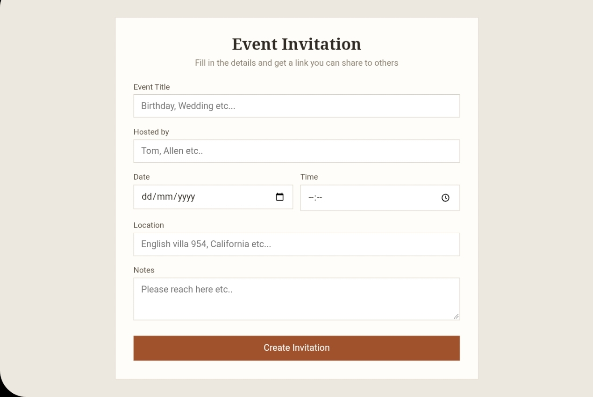
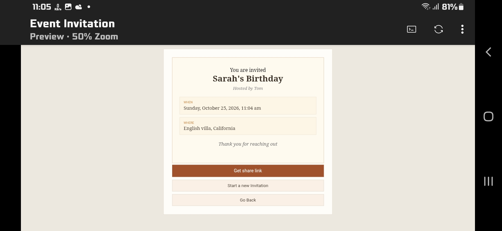

# Event-Invitation
Event inviatation is a small website devloped by DEV L K.
--- 
## Freatures
- Enter details of your invitation in the input boxes
- Click create invite button
- The website will instatly make an invitataion card using those details.
- Then click on the get invite link button
- The website will output a link with inc base64 data
- Send this link to guests

Your data never goes to any database. it is just stored inside the link as base 64.
---
## How to use
go to https://event.devlkakkoth.me

if it is not working go to https://dev-l-k.github.io/Event-Invitation
---
## Tech Stack
- Html
- Css
- JS
- Github Pages
---
## Screenshots
---

---

